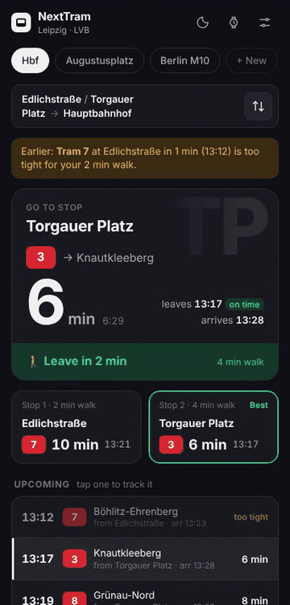
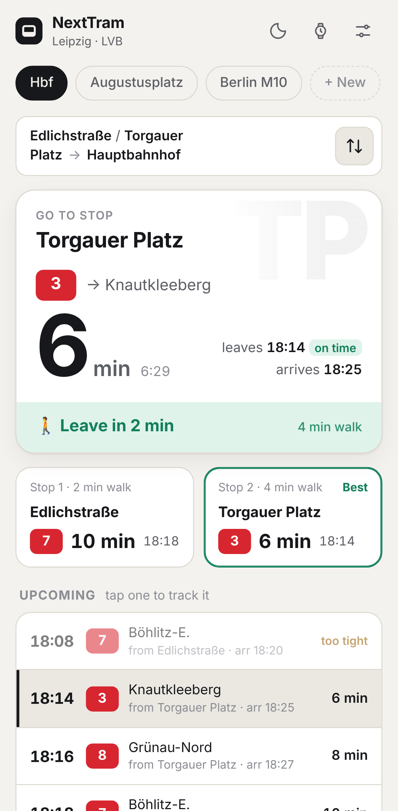
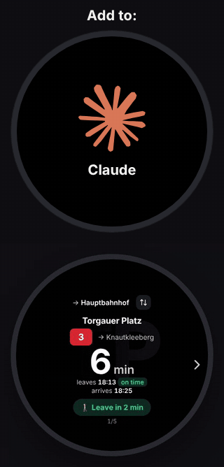

# NextTram

<p align="center">
  
  &nbsp;
  
  &nbsp;
  
</p>
<p align="center"><sub>Tracking a tram and the trip back, light mode, and the watch, which you can also ask through your assistant. Screenshots use sample departures.</sub></p>

**"When is the next tram?"** answered with zero friction: which of your nearby stops to walk to, which tram you can still catch, and when to leave the house.

Live departures for **Leipzig (LVB / MDV)** and **Berlin (BVG / VBB)**. No backend, no database, no API keys. It comes as:

- an installable **PWA** for Android phones and Wear OS watches,
- an **MCP server** so Claude (or any MCP client) can answer "next tram",
- an **Alexa skill** ("Alexa, ask Next Tram: when is the next tram"),
- a **Siri Shortcut** ("Hey Siri, Next Tram") on iPhone and Apple Watch.

All three share one module, [`lib/transit.js`](lib/transit.js).

## How it decides

- **Two home stops in parallel.** A route starts with one stop; **+ Add a second stop** adds another, each with its own walk time (default: Edlichstraße 2 min with Tram 7, Torgauer Platz 4 min with Trams 3 and 8). Both are checked at the same time and the results are merged.
- **Walk buffer.** A tram that leaves sooner than your walk takes is *too tight*. It's skipped for the countdown and greyed out as "too tight" in the list.
- **Punctuality as words.** early (yellow), on time, late (1–3 min), +late (4–7), ++late (8+). Tap a label for the explanation.
- **Leave advice.** "🚶 Leave in 4 min" while you have time, "🏃 Leave now" once departure ≤ walk time.
- **Tap to track.** Tap any upcoming departure or stop card to lock the countdown onto that tram until it leaves. "Back to fastest" returns to automatic mode.
- **Trip back (⇅).** Reverses the route: from the destination to *both* home stops, so you take whichever gets you home first. No walk by default; **+ Add a walk for the trip back** sets one.
- **Engines.** Leipzig uses [Transitous](https://transitous.org) (MOTIS, full MDV/LVB data with real time) and falls back to DB HAFAS (`v6.db.transport.rest`). Berlin uses BVG HAFAS (`v6.bvg.transport.rest`) and falls back to Transitous. A departure only counts if it boards *at the stop you chose*, not at another stop nearby.
- **Stop names.** `edlichstr`, `Edlichstr.`, `Edlichstrasse` and `Edlichstraße` all match. Exact stop IDs are looked up once and remembered on the device.

## Run the app

Needs Node 18+ only for the tiny dev server (the app itself is plain HTML/CSS/JS, no build step):

```bash
npm start          # http://localhost:8080
npm test           # unit tests for the transit logic and the Alexa handler
```

To install it on Android it must be served over HTTPS. It is deployed on **Vercel**: every push to `main` goes live, and every pull request gets its own preview URL. `vercel.json` serves it as plain static files (no build) and keeps the service worker and manifest uncached so updates show up right away; `.vercelignore` leaves the MCP server, Alexa skill, tests and docs out of the deployment. Open the URL in Chrome → menu → **Install app**. Long-press the home-screen icon for shortcuts straight to a route (`?route=lej-hbf`, `?route=lej-hbf&back=1`).

**Watch:** on screens 380 px wide or less (Wear OS browsers) the app switches to a round, glanceable layout automatically. Tap the route name to cycle favorites, tap the countdown to refresh. The ⌚ button previews it on a phone or desktop.

## Favorites

Three routes are built in (see [`lib/stops.js`](lib/stops.js)):

| id | route |
|---|---|
| `lej-hbf` | Edlichstraße / Torgauer Platz → Leipzig Hauptbahnhof |
| `ber-strassmann` | Straßmannstr. → U Eberswalder Str. (Berlin) |

Tap the active chip (or the sliders icon) to edit a route, **+ New** to add one. Your routes are stored only in the browser (`localStorage`).

## Assistants follow your first favorite

The app saves your favorites online under a personal code. Tap **AI** in the app for the step-by-step guide for Claude, ChatGPT, Gemini, Siri and Alexa: each one only needs a personal link, and the assistant then answers for your first favorite. Without a code they use the built-in routes.

The links point at two Vercel functions that need nothing installed:

- `api/mcp.js`: online MCP server (Streamable HTTP, stateless JSON). Claude: Settings → Connectors → Add custom connector. ChatGPT: Developer mode → Create. URL `https://app.nexttram.morgado.tech/api/mcp?code=<code>`.
- `api/alexa.js`: the Alexa skill's HTTPS endpoint, `https://app.nexttram.morgado.tech/api/alexa?code=<code>`, so no AWS Lambda is needed.

Storage is Upstash Redis on the Vercel project: Vercel → Storage → **Upstash for Redis** → connect it to `next-tram`. That sets `KV_REST_API_URL`/`KV_REST_API_TOKEN` (or `UPSTASH_REDIS_REST_*`), which `api/favorites.js` reads. Whoever knows a code can read and replace that list; only stop names, coordinates and walk times are stored.

## MCP server on your own computer (optional)

The tools live in `lib/mcp-tools.js`; `mcp-server.mjs` serves them over stdio:

```json
{
  "mcpServers": {
    "next-tram": {
      "command": "node",
      "args": ["C:/Users/mateu/Documents/projects/next-tram/mcp-server.mjs"],
      "env": { "NEXT_TRAM_CODE": "your-code-from-the-app" }
    }
  }
}
```

Tools: `get_next_tram` (no arguments needed; optional `route`, `back`, a custom `from`/`from2`/`to`, `language: "de"`), `search_stops`, `list_routes`. Set `NEXT_TRAM_ROUTE=ber-strassmann` to change the default.

## Alexa skill

Easiest: follow the Alexa guide in the app (AI button). It points the skill at `api/alexa.js`. To host it yourself instead:

1. Zip `alexa-skill.mjs` together with the `lib/` folder and upload it to an AWS Lambda function (Node.js 20). Handler: `alexa-skill.handler`.
2. In the Alexa developer console create a custom skill, paste `alexa/interaction-model.en-US.json` (and/or `de-DE`) into the JSON editor, and point the endpoint at the Lambda.
3. "Alexa, ask Next Tram: when is the next tram" / "Alexa, frag Nächste Bahn, wann die nächste Bahn kommt". "…next tram home" uses the trip back.

## Siri (Apple Shortcuts)

1. Open **Shortcuts** on your iPhone → **+** → **Add Action** → **Open URLs**.
2. URL: `https://app.nexttram.morgado.tech/?route=lej-hbf` (any favorite's id works; add `&back=1` for the trip back).
3. Name the shortcut **Next Tram**. Now "Hey Siri, Next Tram" opens your route with the countdown, on the iPhone or from the Apple Watch.

## Files

| File | What it is |
|---|---|
| `index.html`, `styles.css`, `app.js` | The PWA (UI, state, countdown) |
| `lib/transit.js` | API clients, stop matching, walk-buffer planning, spoken summary |
| `lib/stops.js` | Cities, stops, default routes |
| `sw.js`, `manifest.webmanifest`, `icons/` | Offline shell and install metadata |
| `mcp-server.mjs`, `lib/mcp-tools.js`, `api/mcp.js` | MCP tools, local stdio server and online server |
| `lib/assistant-guides.js`, `icons/assistants/` | The in-app "Add to your assistant" guides and logos |
| `alexa-skill.mjs`, `alexa/`, `api/alexa.js` | Alexa handler, voice models and online endpoint |
| `test/` | `node --test` suites |
