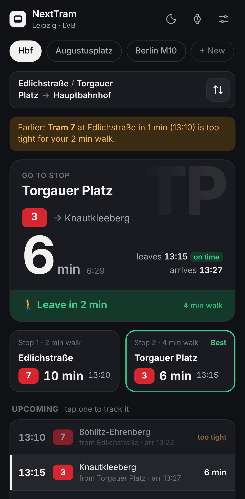
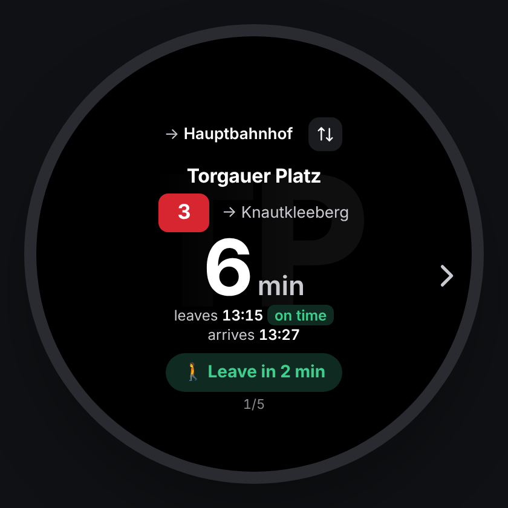

# NextTram

<p align="center">
  
  &nbsp;
  
  &nbsp;
  
</p>
<p align="center"><sub>Phone (dark and light) and watch view. The screenshots use sample departures.</sub></p>

**"When is the next tram?"** answered with zero friction: which of your nearby stops to walk to, which tram you can still catch, and when to leave the house.

Live departures for **Leipzig (LVB / MDV)** and **Berlin (BVG / VBB)**. No backend, no database, no API keys. It comes as:

- an installable **PWA** for Android phones and Wear OS watches,
- an **MCP server** so Claude (or any MCP client) can answer "next tram",
- an **Alexa skill** ("Alexa, ask Next Tram when the next tram is").

All three share one module, [`lib/transit.js`](lib/transit.js).

## How it decides

- **Two home stops in parallel.** A route can have a Stop 1 and an optional Stop 2, each with its own walk time (default: Edlichstraße 2 min with Tram 7, Torgauer Platz 4 min with Trams 3 and 8). Both are checked at the same time and the results are merged.
- **Walk buffer.** A tram that leaves sooner than your walk takes is *too tight*. It's skipped, and an amber notice tells you about it ("Earlier: Tram 7 at Edlichstraße in 1 min is too tight for your 2 min walk").
- **Leave advice.** "🚶 Leave in 4 min" while you have time, "🏃 Leave now" once departure ≤ walk time.
- **Tap to track.** Tap any upcoming departure or stop card to lock the countdown onto that tram until it leaves. "Back to fastest" returns to automatic mode.
- **Trip back (⇅).** Reverses the route: from the destination to *both* home stops, so you take whichever gets you home first. The destination's own walk time is used.
- **Engines.** Leipzig uses [Transitous](https://transitous.org) (MOTIS, full MDV/LVB data with real time) and falls back to DB HAFAS (`v6.db.transport.rest`). Berlin uses BVG HAFAS (`v6.bvg.transport.rest`) and falls back to Transitous. A departure only counts if it boards *at the stop you chose*, not at another stop nearby.
- **Stop names.** `edlichstr`, `Edlichstr.`, `Edlichstrasse` and `Edlichstraße` all match. Exact stop IDs are looked up once and remembered on the device.

## Run the app

Needs Node 18+ only for the tiny dev server (the app itself is plain HTML/CSS/JS, no build step):

```bash
npm start          # http://localhost:8080
npm test           # unit tests for the transit logic and the Alexa handler
```

To install it on Android it must be served over HTTPS (GitHub Pages, Netlify, Vercel, …). Open the URL in Chrome → menu → **Install app**. Long-press the home-screen icon for shortcuts straight to a route (`?route=lej-hbf`, `?route=lej-hbf&back=1`).

**Watch:** on screens 380 px wide or less (Wear OS browsers) the app switches to a round, glanceable layout automatically. Tap the route name to cycle favorites, tap the countdown to refresh. The ⌚ button previews it on a phone or desktop.

## Favorites

Three routes are built in (see [`lib/stops.js`](lib/stops.js)):

| id | route |
|---|---|
| `lej-hbf` | Edlichstraße / Torgauer Platz → Leipzig Hauptbahnhof |
| `lej-augustusplatz` | Edlichstraße / Torgauer Platz → Augustusplatz |
| `ber-m10` | S+U Warschauer Str. → U Eberswalder Str. (Berlin) |

Tap the active chip (or the sliders icon) to edit a route, **+ New** to add one. Your routes are stored only in the browser (`localStorage`).

## MCP server (Claude)

```json
{
  "mcpServers": {
    "next-tram": {
      "command": "node",
      "args": ["C:/Users/mateu/Documents/projects/next-tram/mcp-server.mjs"]
    }
  }
}
```

Tools: `get_next_tram` (no arguments needed; optional `route`, `back`, a custom `from`/`from2`/`to`, `language: "de"`), `search_stops`, `list_routes`. Set `NEXT_TRAM_ROUTE=lej-augustusplatz` to change the default.

## Alexa skill

1. Zip `alexa-skill.mjs` together with the `lib/` folder and upload it to an AWS Lambda function (Node.js 20). Handler: `alexa-skill.handler`.
2. In the Alexa developer console create a custom skill, paste `alexa/interaction-model.en-US.json` (and/or `de-DE`) into the JSON editor, and point the endpoint at the Lambda.
3. "Alexa, ask Next Tram when the next tram is" / "Alexa, frag Nächste Bahn, wann die nächste Bahn kommt". "…next tram home" uses the trip back.

## Files

| File | What it is |
|---|---|
| `index.html`, `styles.css`, `app.js` | The PWA (UI, state, countdown) |
| `lib/transit.js` | API clients, stop matching, walk-buffer planning, spoken summary |
| `lib/stops.js` | Cities, stops, default routes |
| `sw.js`, `manifest.webmanifest`, `icons/` | Offline shell and install metadata |
| `mcp-server.mjs` | MCP stdio server |
| `alexa-skill.mjs`, `alexa/` | Alexa Lambda handler and voice models |
| `test/` | `node --test` suites |
